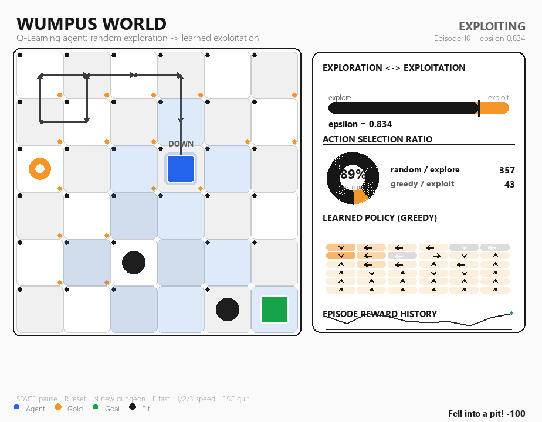

# Wumpus World RL — Exploration vs Exploitation

A **Pygame** implementation of the classic *Wumpus World* puzzle in which a
**Q-learning** reinforcement-learning agent learns to reach the gold.

The agent begins by choosing **random actions (exploration)** and, as its
epsilon decays across episodes, gradually shifts toward **exploiting** the
action-values it has learned. The right-hand panel shows this live trade-off
next to the gameplay.



## Entities (each a distinct shape + colour)

| Entity | Shape   | Colour |
|--------|---------|--------|
| Agent  | circle  | cyan   |
| Gold (goal) | star | gold |
| Pit (hazard) | triangle | red |
| Wumpus (hazard) | diamond | green |

Classic Wumpus-World *percepts* are drawn as subtle halos:
**Breeze** (blue) near pits, **Stench** (lime ring) near the wumpus.

## Requirements

- Python **3.13** and the `pygame` + `numpy` packages.

> ⚠️ **Note:** The default `python` on this machine is 3.14, for which pygame
> has no prebuilt wheel. This project must be run with Python **3.13**, which
> already has `pygame 2.6.1` and `numpy` installed.

```powershell
py -3.13 main.py
```

## How the RL agent works

- **State**: the agent's grid cell `(row, col)`.
- **Actions**: UP / DOWN / LEFT / RIGHT.
- **Rewards**: `+100` gold, `-100` pit or wumpus, `-1` per step (encourages the
  shortest path), `-5` for bumping a wall.
- **Update rule** (tabular Q-learning):
  `Q(s,a) += α · (r + γ · max_a' Q(s',a') − Q(s,a))`
  with learning rate `α = 0.2` and discount `γ = 0.95`.
- **Action selection** (ε-greedy):
  with probability `ε` pick a random action (**exploration**),
  otherwise pick `argmax Q(s,a)` (**exploitation**).
- **ε-schedule**: starts at `1.0` (fully random) and is multiplied by `0.98`
  after every episode, down to a floor of `0.02` — so the agent explores a lot
  early and exploits what it learned later.

All hyper-parameters live in `config.py`.

## The exploration / exploitation panel

Shown **beside the gameplay**:

- **Exploration ↔ Exploitation gauge** — the orange/emerald bar with a marker
  at the current ε value.
- **Action selection ratio** — a donut chart of random-vs-greedy choices plus
  the running counts.
- **Learned policy (greedy)** — a mini map where each cell shows the greedy
  action as an arrow, tinted by the Q-value magnitude.
- **Episode reward history** — a line chart of total reward per episode; it
  trends upward as the agent learns.

## Controls

| Key | Action |
|-----|--------|
| `SPACE` | pause / resume auto-play |
| `R` | reset the agent (forget everything, learn again) |
| `N` | generate a brand-new random dungeon |
| `F` | toggle fast training |
| `1` / `2` / `3` | slow / normal / fast speed |
| click / `Enter` | start next episode after one ends |
| `ESC` | quit |

## Files

- `config.py` — grid, colours, rewards, hyper-parameters, layout.
- `environment.py` — the `WumpusEnv` (gold, pits, wumpus, walls, percepts).
- `agent.py` — the `QLearningAgent` (Q-table, ε-greedy, decay).
- `render.py` — all sprites/shapes and the panel visualisations.
- `main.py` — the Pygame game loop and UI.
- `train_test.py` — headless proof that the agent improves over episodes.
- `screenshot.py` — renders `preview.png` for a quick visual check.

## Verify it learns

```powershell
py -3.13 train_test.py
```

Sample output (reward climbs as ε decays and exploitation takes over):

```
avg reward (first 20): -120.25
avg reward (last  20):   81.25
final epsilon         :  0.0200
explore / exploit     :  729 / 5643
```
